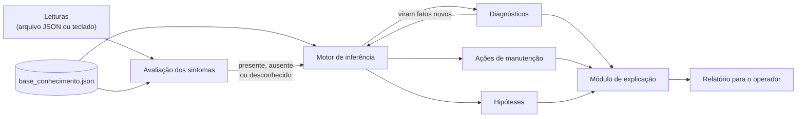

# Sistema especialista para diagnóstico de motores de indução

Sistema especialista em Python que diagnostica falhas de um motor de indução trifásico a partir de leituras de sensores e de observações da equipe de manutenção. Para cada falha, ele mostra a regra que levou à conclusão e recomenda uma ação, da mais grave para a menos grave. Quando faltam dados, o sistema não arrisca um palpite: diz o que precisa ser medido. As regras ficam num arquivo JSON separado do código, então quem entende de motores pode ajustá-las sem programar.

## Índice

- [O problema](#o-problema)
- [Exemplo de uso](#exemplo-de-uso)
- [O equipamento modelado](#o-equipamento-modelado)
- [Sintomas](#sintomas)
- [Base de conhecimento](#base-de-conhecimento)
  - [Diagnósticos](#diagnósticos)
  - [Ações de manutenção](#ações-de-manutenção)
- [Como funciona](#como-funciona)
- [Como executar](#como-executar)
- [Testes](#testes)
- [Limitações e próximos passos](#limitações-e-próximos-passos)
- [Estrutura do projeto](#estrutura-do-projeto)
- [Referências](#referências)

## O problema

Na manutenção de motores, um mesmo sintoma pode ter causas bem diferentes. Um enrolamento acima de 140 °C pode vir de sobrecarga, de alimentação desequilibrada ou de falha no resfriamento, e cada causa pede um reparo diferente. Além disso, os dados quase nunca chegam completos: a resistência de isolamento só é medida com o motor parado, e o espectro de vibração depende de um analista.

O sistema trata esses dois pontos:

- **Regras com negação separam as causas de um mesmo sintoma.** A falha no resfriamento, por exemplo, só é concluída quando a sobrecarga e o desequilíbrio de tensão estão descartados.
- **Cada sintoma tem três valores possíveis: presente, ausente ou desconhecido.** Uma regra que depende de um dado que falta não dispara; vira uma hipótese, e o sistema diz qual leitura a confirmaria.

Um sistema baseado em regras foi escolhido, em vez de um modelo de aprendizado de máquina, por dois motivos. O primeiro é que não há histórico de falhas rotulado para treinar um modelo. O segundo é que cada conclusão precisa ser explicável ao técnico que vai agir sobre ela.

## Exemplo de uso

O arquivo [leitura_exemplo.json](leitura_exemplo.json) simula as leituras de um motor com dois problemas ao mesmo tempo: desalinhamento e defeito de rolamento. Eles costumam aparecer juntos, porque o desalinhamento sobrecarrega os rolamentos. A resistência de isolamento não foi medida.

```powershell
python sistema_especialista.py leitura_exemplo.json
```

```text
==============================================================================
Diagnóstico: Motor de indução trifásico com rotor de gaiola
Equipamento: Motor M-101, bomba de água de resfriamento (leitura simulada)
Leitura: 2026-11-04 14:30
==============================================================================

Sintomas presentes:
  S01  Vibração radial acima de 2,8 mm/s (lido: 4,8 mm/s)
  S02  Vibração radial crítica, acima de 4,5 mm/s (lido: 4,8 mm/s)
  S03  Vibração axial maior que 50 % da radial (lido: 3,1 mm/s; limite: 0,5 ×
       4,8 = 2,4 mm/s)
  S05  Pico dominante em 2× a rotação no espectro de vibração
  S06  Frequências de defeito de rolamento no espectro de envelope
  S07  Ruído anormal no mancal
  S08  Temperatura do mancal acima de 90 °C (lido: 94 °C)

Diagnósticos:
  D1  Defeito no rolamento
      Por quê: R01 (SE S06 ENTÃO D1)
          As frequências de defeito no envelope são a assinatura de dano na
          pista ou nos elementos rolantes, e aparecem antes do ruído e do
          aquecimento.
      Por quê: R02 (SE S07 E S08 ENTÃO D1)
          Ruído no mancal junto com aquecimento indica rolamento danificado ou
          mal lubrificado, mesmo sem análise de vibração.
  D3  Desalinhamento entre motor e bomba
      Por quê: R04 (SE S01 E S05 ENTÃO D3)
          O desalinhamento força o acoplamento duas vezes por volta e gera
          vibração em 2× a rotação.
      Por quê: R05 (SE S01 E S03 ENTÃO D3)
          Vibração axial acima da metade da radial é a assinatura típica do
          desalinhamento angular.

Recomendações de manutenção (da mais grave para a menos grave):
  [IMEDIATA] A9
      Parar o motor assim que possível e inspecionar: na zona D da ISO
      10816-3, a vibração já é severa o bastante para causar dano.
      Origem: R19 (SE S02 ENTÃO A9)
  [URGENTE] A2
      Trocar o rolamento o quanto antes: o aquecimento indica dano avançado,
      com risco de travamento e de dano ao eixo.
      Origem: R12 (SE D1 E S08 ENTÃO A2)
  [PROGRAMADA] A1
      Verificar a lubrificação do mancal (tipo de graxa, quantidade e
      intervalo), planejar a troca do rolamento e acompanhar a tendência do
      espectro de envelope até a troca.
      Origem: R11 (SE D1 ENTÃO A1)
  [PROGRAMADA] A4
      Realinhar motor e bomba com alinhador a laser, corrigir o pé manco e
      inspecionar o acoplamento.
      Origem: R14 (SE D3 ENTÃO A4)

Entradas não informadas: isolamento
```

Cada sintoma mostra a leitura que o ativou, e o S03 mostra também a conta do limite, que é relativo à vibração radial. Os dois diagnósticos foram concluídos por duas regras cada. A parada do motor (A9) vem primeiro: ela é uma regra de segurança, que se aplica a qualquer vibração na zona D da ISO 10816-3, mesmo sem diagnóstico.

## O equipamento modelado

O sistema foi construído para um motor de indução trifásico com rotor de gaiola, o tipo mais usado na indústria para acionar bombas, ventiladores, compressores e esteiras, e com falhas bem documentadas. Para que os limites tenham uma referência concreta, a base considera um motor específico:

- **30 kW, 380 V e 60 Hz.** A potência põe o motor no grupo 2 da ISO 10816-3, que reúne as máquinas de 15 a 300 kW. Essa norma dá os limites de vibração dos sintomas S01 e S02.
- **Instalado sobre base rígida.** A mesma norma tem limites diferentes para base rígida e base flexível.
- **Isolamento classe F.** O limite térmico dessa classe é de 155 °C (IEC 60085), e o sintoma S09 parte dele.
- **Acionando uma bomba centrífuga por acoplamento flexível.** Essa montagem explica dois diagnósticos: o desalinhamento entre os eixos do motor e da bomba, e o desbalanceamento do conjunto que gira.

Numa planta com monitoramento, as leituras viriam de cinco fontes:

- um acelerômetro no mancal, que mede a vibração radial e axial e gera o espectro;
- sensores de temperatura PT100 no mancal e no enrolamento;
- um analisador de energia no painel, para a corrente e os desequilíbrios de tensão e de corrente;
- um megômetro, para a resistência de isolamento, medida com o motor parado;
- o operador, que relata ruído no mancal.

O sistema recebe essas leituras de um arquivo JSON, como o que um sistema de monitoramento enviaria, ou pelo teclado.

## Sintomas

A base tem 12 entradas (as leituras) e 13 sintomas. Cada sintoma é um fato tirado de uma entrada por um limite guardado na própria base. O S01, por exemplo, é verdadeiro quando a vibração radial passa de 2,8 mm/s.

A tabela usa alguns termos da análise de vibração. O **espectro de vibração** é o sinal do acelerômetro decomposto em frequências. **1×** é a frequência de rotação do eixo, e **2×** é o dobro dela. O **espectro de envelope** é um processamento que realça os impactos repetidos de um rolamento danificado; esses impactos aparecem em frequências que dependem da geometria do rolamento.

| Sintoma | Descrição | Entrada e condição | Origem do limite |
|---|---|---|---|
| S01 | Vibração radial acima de 2,8 mm/s | `vib_radial` > 2,8 mm/s | ISO 10816-3, grupo 2, base rígida: fronteira entre as zonas B e C. Na zona C, a norma considera a vibração insatisfatória para operação contínua |
| S02 | Vibração radial crítica | `vib_radial` > 4,5 mm/s | Mesma norma: fronteira entre as zonas C e D. Na zona D, a vibração já pode danificar a máquina |
| S03 | Vibração axial maior que 50 % da radial | `vib_axial` > 0,5 × `vib_radial` | Regra prática da análise de vibração |
| S04 | Pico dominante em 1× no espectro | `pico_1x` = sim | Observação do analista de vibração |
| S05 | Pico dominante em 2× no espectro | `pico_2x` = sim | Observação do analista de vibração |
| S06 | Frequências de defeito de rolamento no envelope | `freq_rolamento` = sim | Observação do analista de vibração |
| S07 | Ruído anormal no mancal | `ruido_mancal` = sim | Observação do operador |
| S08 | Temperatura do mancal acima de 90 °C | `temp_mancal` > 90 °C | Valor adotado no projeto |
| S09 | Temperatura do enrolamento acima de 140 °C | `temp_enrolamento` > 140 °C | Valor adotado, 15 °C abaixo do limite de 155 °C da classe F |
| S10 | Corrente acima da nominal | `corrente` > 100 % | Corrente de placa, supondo fator de serviço 1,0 |
| S11 | Desequilíbrio de tensão acima de 1 % | `deseq_tensao` > 1 % | NEMA MG 1: acima de 1 %, o motor precisa trabalhar com carga reduzida |
| S12 | Desequilíbrio de corrente acima de 10 % | `deseq_corrente` > 10 % | Regra prática da manutenção elétrica; valor adotado |
| S13 | Resistência de isolamento abaixo de 5 MΩ | `isolamento` < 5 MΩ | IEEE 43: mínimo recomendado para enrolamentos abaixo de 1 kV, corrigido para 40 °C |

Os desequilíbrios seguem a definição da NEMA: o maior desvio entre uma fase e a média das três, dividido pela média. Tensões de 380, 384 e 372 V, por exemplo, têm média de 378,7 V e maior desvio de 6,7 V, o que dá 6,7 ÷ 378,7 = 1,8 %.

Cinco limites não vêm de norma. S03 e S12 são regras práticas, S08 e S09 são valores adotados no projeto, e S10 é a corrente de placa do motor. Os quatro primeiros precisam ser ajustados ao manual do fabricante e ao histórico da planta.

## Base de conhecimento

A base fica em [base_conhecimento.json](base_conhecimento.json), separada do código. Ela tem 19 regras SE-ENTÃO: 10 concluem um dos 7 diagnósticos, e 9 concluem uma ação de manutenção. As condições de uma regra são ligadas por E, e todas precisam ser verdadeiras. `NÃO` marca um sintoma que precisa estar ausente; no JSON, ele é escrito sem acento, como em `"NAO S03"`. Quando um diagnóstico tem mais de uma regra, qualquer uma delas basta para concluí-lo, o que funciona como um OU.

### Diagnósticos

| Diagnóstico | Regra | SE | Por quê |
|---|---|---|---|
| D1 Defeito no rolamento | R01 | S06 | As frequências de defeito no envelope aparecem antes do ruído e do aquecimento |
| | R02 | S07 E S08 | Ruído com aquecimento do mancal indica o defeito mesmo sem análise de vibração |
| D2 Desbalanceamento do conjunto girante | R03 | S01 E S04 E NÃO S03 | O desbalanceamento cria uma força que gira com o eixo: vibração radial em 1×, com pouca vibração axial |
| D3 Desalinhamento entre motor e bomba | R04 | S01 E S05 | O acoplamento é forçado duas vezes por volta, o que gera vibração em 2× |
| | R05 | S01 E S03 | Vibração axial acima da metade da radial é a assinatura típica do desalinhamento angular |
| D4 Sobrecarga mecânica | R06 | S10 E NÃO S11 | Corrente acima da nominal com tensão equilibrada: a carga pede mais torque do que o motor fornece em regime contínuo |
| D5 Falha no resfriamento do motor | R07 | S09 E NÃO S10 E NÃO S11 | O enrolamento esquenta sem sobrecorrente e sem desequilíbrio de tensão, então o problema está na retirada do calor |
| D6 Alimentação elétrica desequilibrada | R08 | S11 | O desequilíbrio de tensão cria correntes de sequência negativa, que aquecem o motor |
| D7 Falha no enrolamento do estator | R09 | S13 | Isolamento abaixo do mínimo da IEEE 43: degradado, úmido ou contaminado |
| | R10 | S12 E NÃO S11 | Corrente desequilibrada com tensão equilibrada indica assimetria no próprio motor, como um curto entre espiras |

As negações permitem separar causas diferentes de um mesmo sintoma. O enrolamento quente (S09) pode ter três causas:

- se a corrente passa da nominal, a R06 conclui sobrecarga;
- se a tensão está desequilibrada, a R08 conclui problema na alimentação;
- só quando as duas causas estão descartadas, a R07 conclui falha no resfriamento.

O desequilíbrio de corrente (S12) segue a mesma lógica. A R10 só o atribui ao enrolamento quando a tensão está equilibrada. Se a tensão também está desequilibrada, a causa provável é a alimentação, e o diagnóstico fica com a R08.

### Ações de manutenção

Cada ação tem uma de três prioridades:

- **imediata:** parar o motor ou não religá-lo;
- **urgente:** agir antes da próxima parada planejada;
- **programada:** resolver na próxima parada planejada.

| Ação | Prioridade | Regra | O que fazer |
|---|---|---|---|
| A1 | programada | R11: SE D1 | Verificar a lubrificação do mancal, planejar a troca do rolamento e acompanhar o espectro de envelope até a troca |
| A2 | urgente | R12: SE D1 E S08 | Trocar o rolamento o quanto antes, pelo risco de travamento e de dano ao eixo |
| A3 | programada | R13: SE D2 | Fazer o balanceamento dinâmico e procurar sujeira, desgaste ou peças soltas no rotor da bomba |
| A4 | programada | R14: SE D3 | Realinhar motor e bomba com alinhador a laser, corrigir o pé manco e inspecionar o acoplamento |
| A5 | urgente | R15: SE D4 | Verificar a carga acionada e o dimensionamento do motor; reduzir a carga até a corrente voltar à nominal |
| A6 | urgente | R16: SE D5 | Limpar a carcaça e as aletas, verificar o ventilador e a tampa defletora e conferir a temperatura do ambiente |
| A7 | urgente | R17: SE D6 | Medir as tensões e verificar fusíveis, contatores e conexões; enquanto o desequilíbrio passar de 1 %, reduzir a carga |
| A8 | imediata | R18: SE D7 | Não operar o motor até confirmar a falha com ensaios do enrolamento; depois, secar, limpar ou rebobinar |
| A9 | imediata | R19: SE S02 | Parar o motor assim que possível e inspecioná-lo, porque a vibração está na zona D |

O texto completo de cada ação está na base. A maioria das regras liga um diagnóstico à ação dele, mas duas fogem desse padrão:

- A R12 combina um diagnóstico com um sintoma para subir a prioridade. O mesmo defeito de rolamento pede troca urgente quando o mancal já está aquecendo.
- A R19 é uma regra de segurança. Ela parte direto de um sintoma e recomenda parar o motor mesmo que nenhum diagnóstico tenha sido concluído.

## Como funciona



Leia o diagrama da esquerda para a direita. As leituras viram sintomas pelos limites da base, e o motor de inferência aplica as regras da mesma base. Cada diagnóstico concluído volta ao motor como fato novo e dispara a ação correspondente. No fim, o módulo de explicação monta o relatório com o porquê de cada conclusão.

Sempre que a base é carregada, antes de qualquer consulta, a função `validar_base()` a confere. A validação recusa, por exemplo, uma regra que cita um sintoma inexistente, a negação de um diagnóstico e uma prioridade desconhecida. Assim, quem edita o JSON vê o erro na hora, e não no meio de um diagnóstico. As leituras também são conferidas: um texto numa entrada numérica ou um nome de entrada desconhecido são recusados.

Depois, a consulta passa por quatro etapas:

1. **Avaliação dos sintomas** (`avaliar_sintomas`). Cada sintoma recebe um de três valores: presente, ausente ou desconhecido. Um sintoma fica desconhecido quando falta a leitura de que ele depende.
2. **Encadeamento para frente** (`inferir`). O motor percorre as regras e dispara toda aquela cujas condições são verdadeiras. A conclusão vira um fato novo, que pode disparar outras regras, e o laço se repete até uma volta inteira passar sem disparo novo. No [exemplo de uso](#exemplo-de-uso), uma das cadeias é esta: `freq_rolamento` = sim → S06 → R01 → D1 → R11 → A1.
3. **Hipóteses.** Uma regra de diagnóstico que não disparou só por falta de dados vira hipótese, desde que pelo menos uma das condições seja verdadeira. O E de três valores funciona assim:
   - a regra é falsa se alguma condição é falsa;
   - fica indeterminada se nenhuma é falsa, mas alguma é desconhecida;
   - é verdadeira quando todas são verdadeiras.

   Para cada hipótese, o sistema diz qual entrada informar. É a ideia do encadeamento para trás: partir de um diagnóstico possível e procurar o dado que falta para confirmá-lo.
4. **Módulo de explicação** (`formatar_relatorio`). O motor guarda as regras na ordem em que dispararam. O relatório mostra, para cada diagnóstico, a regra que o concluiu e a justificativa dela (linha "Por quê"). Para cada ação, mostra a regra que a gerou (linha "Origem").

Só sintomas podem ser negados nas regras. Com isso, a inferência é monotônica: um fato concluído nunca deixa de valer, e a ordem das regras no arquivo não muda o resultado.

O código segue os componentes clássicos de um sistema especialista:

| Componente | Onde está |
|---|---|
| Base de conhecimento | [base_conhecimento.json](base_conhecimento.json) |
| Motor de inferência | `avaliar_sintomas()` e `inferir()` |
| Interface com o usuário | `perguntar_leituras()` (teclado), `main()` (arquivo) e `formatar_relatorio()` (saída) |
| Aquisição de conhecimento | Edição do JSON, conferida por `validar_base()` |
| Módulo de explicação | Lista de regras disparadas e campo `porque` de cada regra, mostrados por `formatar_relatorio()` |

## Como executar

O sistema só usa a biblioteca padrão do Python 3, sem pacotes extras. Foi testado com o Python 3.13 e o 3.14. Na pasta do projeto:

```powershell
# Diagnóstico a partir de um arquivo de leituras
python sistema_especialista.py leitura_exemplo.json

# Modo interativo: o programa pergunta cada leitura
python sistema_especialista.py

# Testes (com -v, mostra também o relatório completo de cada caso)
python testes.py
python testes.py -v
```

No modo interativo, deixe a resposta em branco (Enter) para uma leitura que não foi feita. Os números aceitam vírgula ou ponto, e as perguntas de sim ou não aceitam `s` ou `n`.

No Spyder, abra o `sistema_especialista.py` e rode com F5: as perguntas aparecem no console. Para usar um arquivo de leituras, defina a pasta do projeto como diretório de trabalho e digite no console:

```python
%run sistema_especialista.py leitura_exemplo.json
```

Para avaliar outro motor ou outra leitura, crie um JSON no mesmo formato do [leitura_exemplo.json](leitura_exemplo.json). Para mudar limites, regras ou ações, edite o [base_conhecimento.json](base_conhecimento.json) e rode os testes de novo.

## Testes

O [testes.py](testes.py) roda 13 casos com leituras simuladas. Para cada um, ele compara três resultados com os esperados: os diagnósticos, as ações (na ordem de prioridade) e as hipóteses. Os valores esperados foram definidos a partir das regras da [base de conhecimento](#base-de-conhecimento). O script termina com código 1 se algum caso falhar, então pode ser usado num pipeline de integração contínua.

O caso T01 representa um motor saudável em operação: vibração radial de 1,2 mm/s e axial de 0,4 mm/s, nenhum pico no espectro e nenhum ruído, mancal a 62 °C, enrolamento a 105 °C, corrente de 85 % da nominal e desequilíbrios de 0,4 % na tensão e de 3 % na corrente. A resistência de isolamento fica sem leitura, porque só pode ser medida com o motor parado. Os casos T02 a T09 e o T13 partem dessas leituras e mudam só o que a tabela indica. Os casos T10 e T12 informam uma única leitura, e o T11 é o [exemplo de uso](#exemplo-de-uso).

| Caso | Situação simulada | Leituras (em relação ao T01) | Sintomas presentes | Diagnósticos | Ações | Hipóteses |
|---|---|---|---|---|---|---|
| T01 | Motor em condição normal | nenhuma mudança | nenhum | nenhum | nenhuma | nenhuma |
| T02 | Rolamento com defeito inicial | `freq_rolamento` = sim | S06 | D1 | A1 | nenhuma |
| T03 | Rolamento com defeito avançado | `freq_rolamento` = sim; `ruido_mancal` = sim; `temp_mancal` = 97 °C | S06, S07, S08 | D1 | A2, A1 | nenhuma |
| T04 | Desbalanceamento severo | `vib_radial` = 5,2 mm/s; `vib_axial` = 1,1 mm/s; `pico_1x` = sim | S01, S02, S04 | D2 | A9, A3 | nenhuma |
| T05 | Desalinhamento | `vib_radial` = 3,6 mm/s; `vib_axial` = 2,6 mm/s; `pico_2x` = sim | S01, S03, S05 | D3 | A4 | nenhuma |
| T06 | Sobrecarga | `temp_enrolamento` = 146 °C; `corrente` = 118 % | S09, S10 | D4 | A5 | nenhuma |
| T07 | Falha no resfriamento | `temp_enrolamento` = 148 °C; `corrente` = 93 % | S09 | D5 | A6 | nenhuma |
| T08 | Alimentação desequilibrada | `temp_enrolamento` = 146 °C; `corrente` = 97 %; `deseq_tensao` = 3 %; `deseq_corrente` = 19 % | S09, S11, S12 | D6 | A7 | nenhuma |
| T09 | Curto entre espiras com o motor em operação | `temp_enrolamento` = 125 °C; `corrente` = 98 %; `deseq_corrente` = 16 % | S12 | D7 | A8 | nenhuma |
| T10 | Isolamento baixo no ensaio com o motor parado | só `isolamento` = 2 MΩ | S13 | D7 | A8 | nenhuma |
| T11 | Falhas combinadas | as de [leitura_exemplo.json](leitura_exemplo.json) | S01, S02, S03, S05, S06, S07, S08 | D1, D3 | A9, A2, A1, A4 | nenhuma |
| T12 | Só a vibração radial foi medida | só `vib_radial` = 4 mm/s | S01 | nenhum | nenhuma | D2 (R03), D3 (R04 e R05) |
| T13 | Pico em 1× sem a medição axial | `vib_radial` = 3,4 mm/s; `pico_1x` = sim; `vib_axial` sem leitura | S01, S04 | nenhum | nenhuma | D2 (R03), D3 (R05) |

Fonte: saída de `python testes.py`, que roda `diagnosticar()` com as leituras de cada caso, no Python 3.13 e no 3.14. Em todos os 13 casos, o resultado obtido foi igual ao esperado.

O mesmo script faz mais duas conferências. Na validação, passam as 3 verificações: o sistema recusa uma regra com sintoma inexistente (V1), texto numa entrada numérica (V2) e uma entrada com nome desconhecido (V3). Na cobertura, as 19 regras da base disparam em pelo menos um caso.

Os casos mostram como as regras se comportam:

- **Mesmo sintoma, causas diferentes.** Nos casos T06, T07 e T08, o enrolamento passa de 140 °C, e o sistema chega a três diagnósticos diferentes conforme a corrente e a tensão. Algo parecido acontece entre T08 e T09: o desequilíbrio de corrente é atribuído à alimentação quando a tensão também está desequilibrada, e ao enrolamento quando não está.
- **Mesmo diagnóstico, prioridades diferentes.** T02 e T03 concluem o mesmo defeito de rolamento. No T03, o mancal está a 97 °C, e a R12 acrescenta a troca urgente (A2).
- **A segurança vem primeiro.** No T04, a vibração de 5,2 mm/s está na zona D, e a parada (A9, imediata) aparece antes do balanceamento (A3, programada).
- **Sem dados, sem palpite.** Nos casos T12 e T13, nenhum diagnóstico é confirmado, e o sistema diz o que falta medir. No T13, uma única leitura, a vibração axial, decide entre desbalanceamento e desalinhamento.

No caso T13, a saída termina com as hipóteses, porque falta a vibração axial:

```text
Hipóteses a confirmar (faltam dados):
  D2  Desbalanceamento do conjunto girante, pela regra R03, se:
      S03 estiver ausente: Vibração axial maior que 50 % da radial (informe
          vib_axial)
  D3  Desalinhamento entre motor e bomba, pela regra R05, se:
      S03 estiver presente: Vibração axial maior que 50 % da radial (informe
          vib_axial)
```

## Limitações e próximos passos

- **Os testes verificam o programa, mas não validam a base.** Os casos foram escritos a partir das mesmas regras, então confirmam que o código faz o que a base diz. Para saber se a base acerta em motores reais, seria preciso testá-la com o histórico de falhas de uma planta e com a revisão de um especialista em manutenção.
- **Os limites são nítidos.** Uma vibração de 2,79 mm/s não ativa o S01, e uma de 2,81 mm/s ativa. Com lógica fuzzy, cada sintoma teria um grau entre 0 e 1, e a conclusão mudaria aos poucos.
- **Quatro limites precisam de ajuste** ao fabricante e à planta: os de S03, S08, S09 e S12, como diz a seção [Sintomas](#sintomas).
- **O espectro chega como sim ou não**, informado pelo analista. Num sistema completo, o próprio software do acelerômetro calcularia o espectro e reconheceria os picos.
- **A R05 pode confundir causas.** Num rotor em balanço, como o de muitas bombas centrífugas, o desbalanceamento também gera vibração axial alta, e a regra concluiria desalinhamento.
- **A base cobre 7 falhas.** Ficaram de fora, por exemplo, a folga mecânica, as barras quebradas no rotor e a cavitação da bomba. Para incluí-las, basta acrescentar entradas, sintomas e regras ao JSON, sem mudar o código.
- **As hipóteses só listam o que falta.** Uma versão com encadeamento para trás completo faria ao operador só as perguntas necessárias para confirmar ou descartar cada hipótese.

## Estrutura do projeto

| Arquivo | Conteúdo |
|---|---|
| [sistema_especialista.py](sistema_especialista.py) | Motor de inferência, módulo de explicação e interface |
| [base_conhecimento.json](base_conhecimento.json) | Base de conhecimento: entradas, sintomas, diagnósticos, ações e regras |
| [testes.py](testes.py) | 13 casos de teste, 3 verificações da validação e a cobertura das regras |
| [leitura_exemplo.json](leitura_exemplo.json) | Leituras simuladas, no formato que um sistema de monitoramento enviaria |

## Referências

- ISO 10816-3:2009. Avaliação da vibração de máquinas industriais com potência acima de 15 kW, por medições nas partes não rotativas. Substituída pela ISO 20816-3:2022.
- NEMA MG 1. *Motors and Generators*. Efeito do desequilíbrio de tensão nos motores de indução e redução de carga acima de 1 %.
- IEEE Std 43-2013. *IEEE Recommended Practice for Testing Insulation Resistance of Electric Machinery*.
- IEC 60085. *Electrical insulation: thermal evaluation and designation*. Classes térmicas de isolamento, como a classe F (155 °C).

As regras práticas citadas na base, como a da vibração axial (S03), a do desequilíbrio de corrente (S12) e a dos 10 °C que reduzem à metade a vida do isolamento (R15), são de uso corrente na manutenção e não vêm de uma norma específica.
