# Detecção de trincas em discos de freio por visão computacional

Pipeline em Python e OpenCV que localiza trincas térmicas na pista de um disco de freio a partir de uma única foto, separa essas trincas dos riscos normais de desgaste e decide se o disco passa na triagem. A ideia central é usar a direção das linhas: as trincas térmicas são radiais, e os riscos de desgaste são circulares. Na foto de exemplo, o código marcou 81 trincas e reprovou o disco.

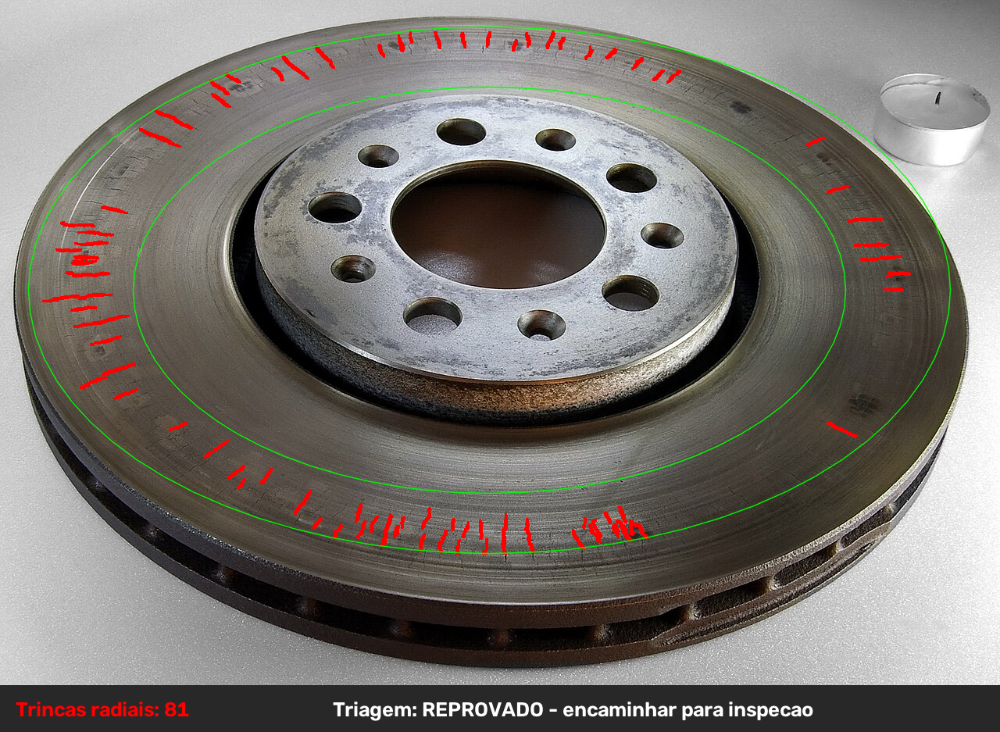

*As 81 trincas detectadas aparecem em vermelho; as elipses verdes limitam a pista analisada.*

## Índice

- [O problema](#o-problema)
- [A ideia: desenrolar a pista](#a-ideia-desenrolar-a-pista)
- [Resultados](#resultados)
- [Como funciona, etapa por etapa](#como-funciona-etapa-por-etapa)
- [Validação com um disco sintético](#validação-com-um-disco-sintético)
- [Decisões de projeto](#decisões-de-projeto)
- [Como executar](#como-executar)
- [Limitações e próximos passos](#limitações-e-próximos-passos)
- [Estrutura do projeto](#estrutura-do-projeto)
- [Créditos e referências](#créditos-e-referências)

## O problema

O disco de freio é uma peça de segurança. A cada frenagem, a pastilha converte energia cinética em calor na pista do disco, que pode chegar a algumas centenas de graus antes de esfriar. Esses ciclos de aquecimento e resfriamento causam fadiga térmica, que aparece primeiro como trincas finas e radiais na pista. Se elas crescem, podem atravessar o disco.

Na manutenção, a inspeção desse defeito é visual e depende do olho e da experiência do técnico. Trincas de poucos milímetros passam despercebidas, principalmente com iluminação ruim ou no meio dos riscos circulares que o atrito com a pastilha deixa em qualquer disco usado. O projeto simula uma estação de inspeção: uma câmera fotografa o disco, e o código aponta onde há trincas e se o disco deve ir para uma avaliação detalhada.

A foto usada é a de um disco ventilado de automóvel com trincas térmicas, retirado da roda dianteira de tração depois de cerca de 15.000 km, segundo a descrição do arquivo (créditos no fim). A versão usada tem 1280 × 877 pixels.

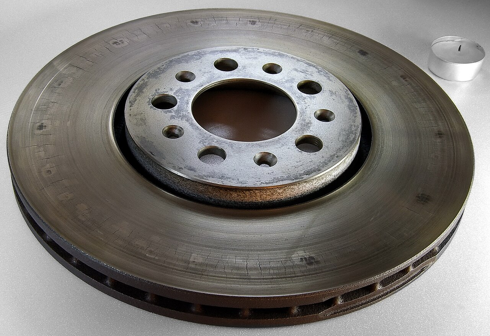

*A foto original. A vela à direita foi posta pelo autor da foto como referência de tamanho.*

Quatro elementos da foto importam para a análise:

- **Trincas térmicas:** linhas escuras, finas e curtas, no sentido do raio, espalhadas pela parte externa da pista. São o defeito procurado.
- **Riscos de desgaste:** linhas circulares concêntricas, deixadas pelo atrito com a pastilha. São normais e não devem ser confundidos com trincas.
- **Pontos quentes:** manchas escuras na pista, regiões que esquentaram mais que o resto.
- **Corrosão no cubo:** a parte central, mais clara, não sofre atrito e fica fora da análise.

## A ideia: desenrolar a pista

Um detector de bordas comum, como o Canny, marca tudo ao mesmo tempo: trincas, riscos, furos e o contorno do cubo. A diferença entre trinca e risco está na direção. Se a pista do disco for "desenrolada" numa faixa retangular, com o ângulo nas linhas e o raio nas colunas, as trincas viram traços paralelos às linhas, e os riscos viram traços paralelos às colunas. Aí um filtro que só enxerga uma direção separa as duas coisas, mesmo onde elas se cruzam.

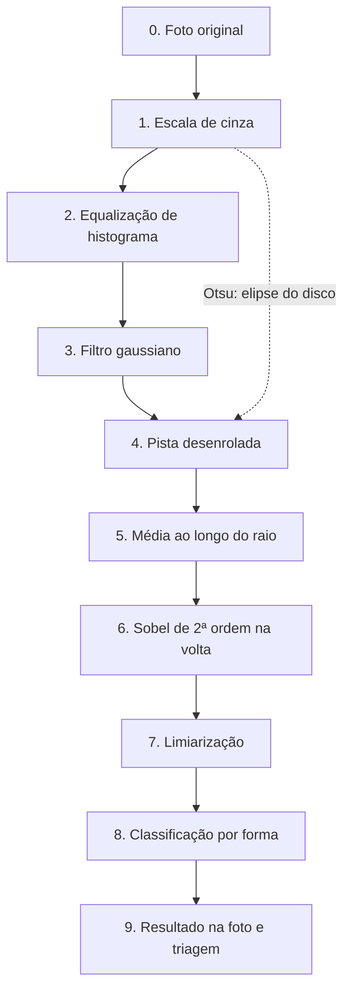

Leia de cima para baixo: cada etapa recebe a imagem da etapa anterior. A seta tracejada é a única entrada lateral. A etapa 4 precisa saber onde está o disco, e essa informação vem de uma limiarização de Otsu sobre a imagem em cinza.

## Resultados

A tabela resume o que o código imprime ao analisar a foto.

| Medida | Valor |
|---|---|
| Limiar de Otsu (disco × fundo) | 125 |
| Elipse da face do disco | centro (626, 372), semieixos 609 × 347 px |
| Faixa desenrolada | 2.633 linhas (ângulos) × 120 colunas (raios) |
| Pixels da faixa acima do limiar | 13.784 de 315.960 (4,4 %) |
| Trincas radiais | 81 |
| Outras manchas descartadas | 276 |
| Comprimento das trincas | mínimo 20, mediana 30 e máximo 74 colunas, de 120 |
| Triagem | Reprovado, encaminhar para inspeção |
| Tempo de execução | cerca de 2 segundos |

Fonte: saída de `python deteccao_trincas.py` com a foto do repositório. A porcentagem é 13.784 ÷ 315.960 = 4,4 %. As 2.633 linhas são o comprimento, em pixels, da volta no meio da pista (86 % do raio).

O comprimento em colunas mede uma fração do raio do disco: as 120 colunas cobrem de 75 % a 97 % do raio, então cada coluna corresponde a 0,22 ÷ 119 ≈ 0,0018 do raio. A trinca mediana, de 30 colunas, tem cerca de 5,5 % do raio, e a maior, de 74 colunas, cerca de 14 %. Para converter em milímetros, seria preciso saber o diâmetro do disco, que a foto não informa.

A ampliação abaixo compara a foto original com o resultado no trecho com mais trincas, escolhido pelo próprio código.

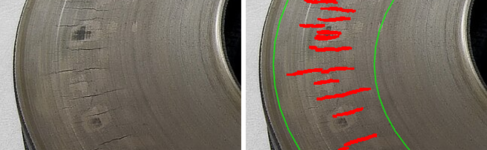

*Ampliação 2× de um trecho de 320 × 200 px, que começa no ponto (0, 286) da foto. As marcas vermelhas caem sobre as trincas visíveis na original. Uma delas fica sobre um ponto quente escuro, junto de uma trinca; pela foto, não dá para dizer se ela marcou a trinca ou a borda da mancha.*

A tabela seguinte divide as trincas pelos quadrantes do disco e mostra o brilho médio da pista em cada um.

| Quadrante | Trincas | Brilho médio da pista (0 a 255) |
|---|---|---|
| Direita | 8 | 72 |
| Baixo | 33 | 87 |
| Esquerda | 19 | 103 |
| Cima | 21 | 131 |
| Total | 81 | — |

Fonte: mesma execução. O brilho é a média dos tons de cinza da pista desenrolada a partir da imagem em cinza, antes da equalização, em cada quadrante.

O que os números dizem:

- **O resultado é coerente com a inspeção visual.** As marcas caem sobre trincas visíveis, e os riscos de desgaste, que cruzam a pista inteira, não foram confundidos com trincas. As trincas estão nos quatro quadrantes, na parte externa da pista. É o padrão de fadiga térmica, espalhada pela volta inteira, e não o de um dano localizado, como um impacto.
- **A triagem reprovou o disco com folga.** Bastaria uma trinca, e foram detectadas 81. Mesmo que parte delas fosse falso positivo, o resultado não mudaria. O disco vai para inspeção, e quem decide a troca é o técnico, com o critério do fabricante.
- **A iluminação influi no resultado.** O quadrante da direita é o mais escuro (brilho 72) e o que tem menos trincas (8). Na foto, as trincas da direita existem, mas aparecem com menos contraste. Com uma foto só, não dá para separar quanto dessa diferença é do disco e quanto é da luz, então a contagem por quadrante não deve ser lida como mapa de gravidade. Numa estação de inspeção, a iluminação uniforme é parte do projeto.

## Como funciona, etapa por etapa

O código está em [deteccao_trincas.py](deteccao_trincas.py). A função `processar` roda as etapas em ordem, e cada uma grava a sua imagem em [imagens/](imagens/) antes de passar o resultado adiante.

**Etapa 1, escala de cinza** (`cv2.cvtColor`). A trinca se distingue por ser mais escura que o metal em volta, não por ter outra cor. Trabalhar com um canal só simplifica todas as etapas seguintes.

**Etapa 2, equalização de histograma** (`cv2.equalizeHist`). O histograma conta quantos pixels há em cada tom; a equalização redistribui os tons por toda a faixa de 0 a 255, o que aumenta o contraste das trincas. Ela também deixa o histograma de fotos diferentes parecido, e assim o limiar fixo da etapa 7 fica menos dependente da exposição da câmera. Ela não corrige, porém, a diferença de luz entre regiões da mesma foto, porque aplica a mesma conversão de tons à imagem inteira.

**Etapa 3, filtro gaussiano** (`cv2.GaussianBlur`, σ = 1,5). As derivadas da etapa 6 amplificam qualquer variação brusca, inclusive o ruído da compressão JPEG e a textura fina do metal. O filtro gaussiano faz uma média dos vizinhos com peso maior no centro; ele tira esse ruído e preserva as trincas, que têm de 2 a 4 px de largura, da ordem do σ escolhido. O filtro de mediana foi descartado porque apaga linhas mais finas que metade da janela.

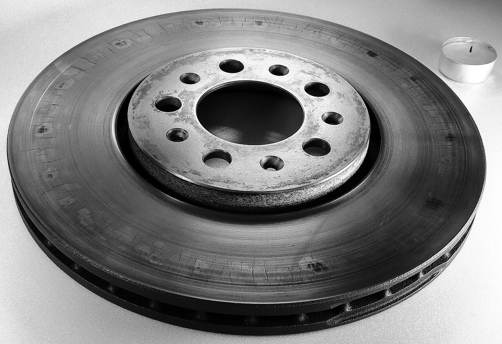

*A imagem equalizada (`02_equalizada.png`): as trincas da borda ficam mais escuras e visíveis. As saídas da escala de cinza e do filtro gaussiano estão em `01_cinza.png` e `03_suavizada.png`.*

**Etapa 4, pista desenrolada** (transformação geométrica com `cv2.remap`). Acontece em três passos.

1. *Achar o disco.* Uma limiarização de Otsu sobre a imagem em cinza separa o disco, escuro, do fundo, claro. O método de Otsu escolhe o limiar que melhor separa os dois grupos de tons do histograma; aqui, ele deu 125. Operações morfológicas tapam os buracos da máscara, porque o cubo e alguns reflexos também são claros: um fechamento, a escolha do maior objeto e o preenchimento da envoltória convexa.
2. *Ajustar a elipse da face.* Na foto oblíqua, a face do disco é uma elipse. Os extremos da linha mais larga da silhueta dão o centro e o semieixo horizontais. O centro e o semieixo verticais saem de um ajuste por mínimos quadrados ao arco de cima da silhueta, que não sofre interferência da lateral do disco, visível embaixo.
3. *Desenrolar.* A pista entre 75 % e 97 % do raio vira uma faixa: cada linha é um ângulo, e cada coluna é um raio. O limite interno exclui o cubo, e o externo exclui a aresta do disco, cujo brilho confundiria os filtros. Os ângulos não são espaçados igualmente: cada linha da faixa cobre cerca de 1 px de arco, para que uma trinca tenha a mesma espessura na faixa em qualquer ponto da volta.

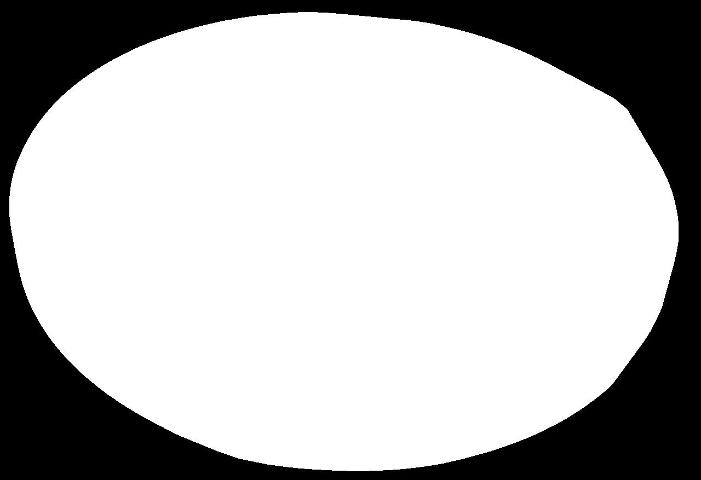

*Silhueta do disco pela limiarização de Otsu (`aux_silhueta_otsu.png`). O corte reto no canto superior direito é a envoltória convexa passando por cima da aresta brilhante, que o Otsu tomou por fundo; esse trecho não entra no ajuste da elipse.*

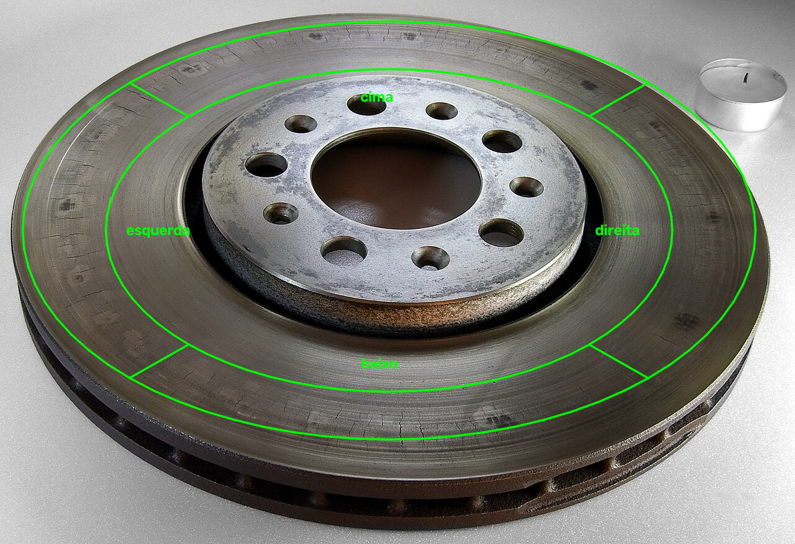

*Região analisada (`aux_regiao_analisada.png`): as elipses verdes limitam a pista, e as divisas separam os quatro quadrantes, na ordem em que a pista é desenrolada.*

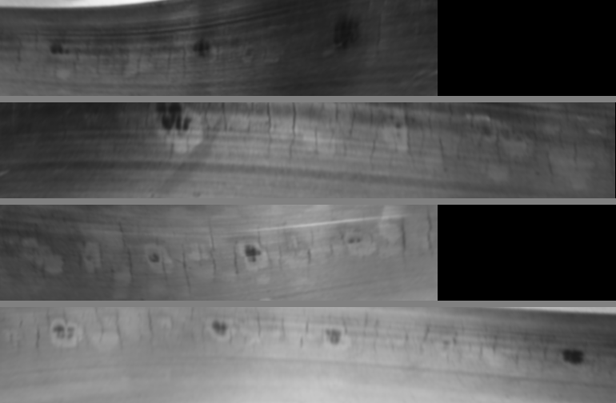

*Pista desenrolada (`04_pista_desenrolada.png`). Cada faixa é um quadrante, de cima para baixo: direita, baixo, esquerda e cima. Em cada faixa, o raio externo fica em cima, e o ângulo cresce da esquerda para a direita; as áreas pretas completam os quadrantes laterais, que têm arco menor. As trincas aparecem como traços verticais curtos; os riscos, como linhas horizontais; e os pontos quentes, como manchas escuras.*

**Etapa 5, filtro de média de 1 × 5 ao longo do raio** (`cv2.blur(faixa, (5, 1))`). Na faixa, a trinca é contínua na direção do raio, então a média nessa direção quase não a altera. O ruído, que muda de um pixel para outro, diminui.

**Etapa 6, Sobel de 2ª ordem na direção da volta** (`cv2.Sobel(faixa, cv2.CV_32F, 0, 2, ksize=5)`). O operador de Sobel aproxima derivadas com núcleos pequenos; em segunda ordem e numa direção só, ele responde a linhas escuras atravessadas por essa direção e ignora as linhas paralelas a ela. Uma trinca é um vale escuro que a volta atravessa, e ali a segunda derivada é positiva. Os riscos circulares não variam ao longo da volta, então a resposta a eles é quase nula. A parte negativa (linhas claras) é descartada.

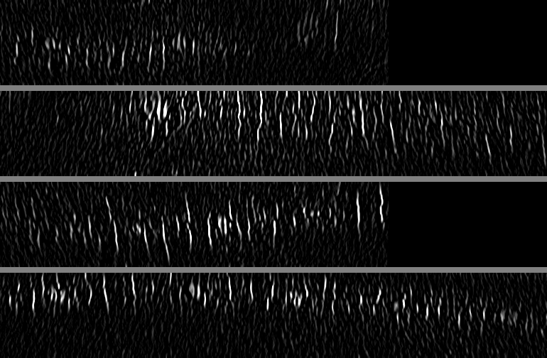

*Sobel de 2ª ordem na direção da volta (`06_sobel_na_volta.png`): só os traços verticais, que são as trincas, acendem. A média da etapa 5 está em `05_media_ao_longo_do_raio.png`.*

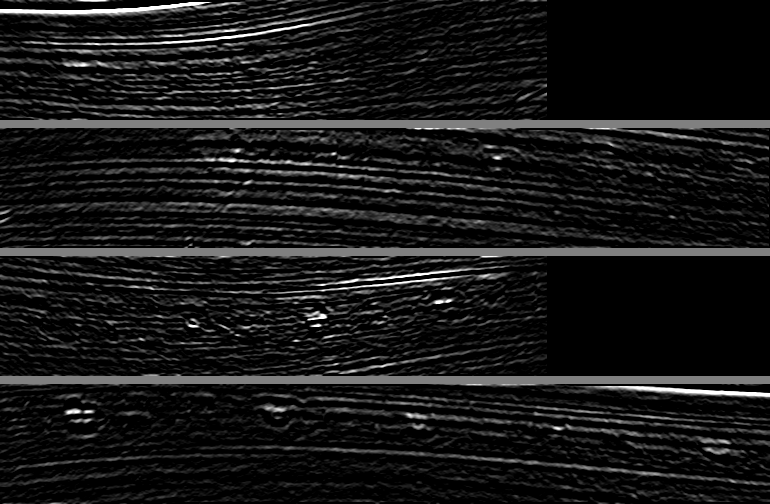

*A mesma derivada na direção do raio (`aux_sobel_no_raio_riscos.png`), só para comparação: agora acendem os riscos de desgaste e a aresta brilhante, e as trincas somem. As duas imagens juntas mostram que a direção separa os dois fenômenos.*

**Etapa 7, limiarização** (limiar fixo de 75). Ficam brancos os pixels com resposta forte: 4,4 % da faixa.

**Etapa 8, classificação por forma.** Cada mancha branca (componente conectado, `cv2.connectedComponentsWithStats`) é medida pelo eixo principal da nuvem de pixels dela, calculado pela covariância das coordenadas:

- **comprimento:** √(12 λ₁), em que λ₁ é a maior variância; é o comprimento de um segmento de reta com essa variância;
- **alongamento:** √(λ₁ / λ₂), a razão entre os eixos (1 é uma mancha redonda);
- **desvio:** o ângulo entre o eixo principal e a direção do raio.

É trinca a mancha com pelo menos 20 colunas de comprimento, alongamento de pelo menos 3 e desvio de até 30°. A tolerância de 30° absorve a perspectiva da foto e as trincas que não são perfeitamente radiais. Manchas curtas, redondas ou inclinadas demais são pontos quentes, marcas ou ruído e são descartadas.

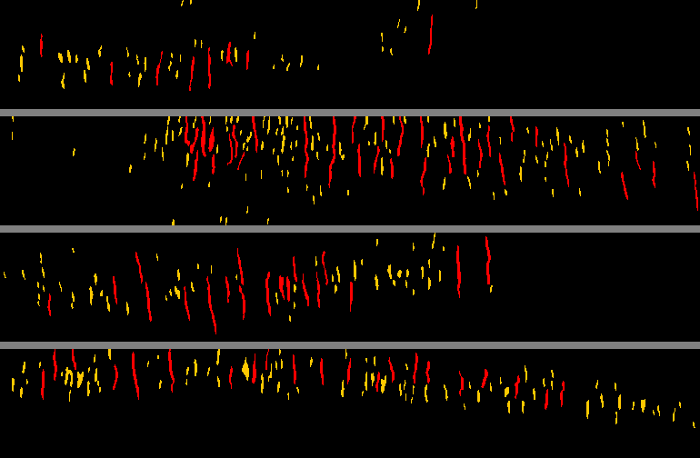

*Classificação por forma (`08_classificacao.png`): em vermelho, as manchas aceitas como trinca; em amarelo, as descartadas. A imagem limiarizada da etapa 7 está em `07_limiarizada.png`.*

**Etapa 9, resultado na foto e triagem.** O código leva a faixa classificada de volta à posição original na foto (`enrolar_de_volta`), pinta as trincas de vermelho e desenha os limites da pista (imagem do topo deste README). A triagem é conservadora: qualquer trinca reprova o disco e o encaminha para inspeção.

Um detalhe prático: o `cv2.imread` e o `cv2.imwrite` não abrem caminhos com acento no Windows. Por isso o código lê o arquivo como bytes com o NumPy (`np.fromfile`) e decodifica com `cv2.imdecode`; na gravação, faz o caminho inverso (`cv2.imencode` e `tofile`).

## Validação com um disco sintético

Numa foto real, não se sabe quantas trincas existem de fato, então não dá para medir acertos e erros. Para testar o pipeline com uma resposta conhecida, o código desenha um disco sintético em perspectiva (`python deteccao_trincas.py --teste`):

- elipse da face com centro (640, 420) e semieixos 580 × 340 px;
- 8 trincas radiais escuras, 2 em cada quadrante, entre 80 % e 93 % do raio;
- 4 riscos circulares contínuos, que cruzam todas as trincas;
- luz mais forte à esquerda, como na foto, e ruído leve imitando a textura do metal.

| Verificação | Esperado | Obtido |
|---|---|---|
| Elipse da face | (640, 420), 580 × 340 | (640, 419), 578 × 339 |
| Trincas por quadrante | 2, 2, 2, 2 | 2, 2, 2, 2 |
| Riscos confundidos com trinca | 0 | 0 |
| Outras manchas descartadas | — | 1 |

Fonte: saída de `python deteccao_trincas.py --teste`. O teste termina com "Teste: passou" quando cada quadrante tem exatamente 2 trincas, e com código de saída 1 quando falha. A linha dos riscos foi conferida na imagem final do teste, em que só as 8 trincas desenhadas aparecem em vermelho.

O teste mostra que o pipeline acha trincas cruzadas por riscos contínuos, a situação em que a primeira versão falhou (próxima seção), e que a elipse é estimada com erro de 1 a 2 px. Ele não mostra que o pipeline acertaria numa foto real com outra iluminação.

## Decisões de projeto

O pipeline atual é a terceira versão. As duas primeiras foram testadas na foto e no disco sintético, e os problemas encontrados explicam as escolhas da versão final.

- **Canny direto na foto.** Marcou os furos, o contorno do cubo, os riscos e as trincas, todos iguais. Sem saber a direção nem o tipo de cada borda, não havia como separar as trincas.
- **k-means para isolar a pista.** Com 3 e 4 grupos de cor, a iluminação, mais forte à esquerda, fez a própria pista se dividir em grupos diferentes. A região de interesse passou a vir da elipse do disco.
- **Laplaciano na foto e direção de cada mancha (primeira versão).** O laplaciano, uma segunda derivada em todas as direções, realçou as trincas e, junto com elas, os riscos. Na foto, onde os riscos são fracos e interrompidos, o resultado parecia bom. No disco sintético, em que os riscos são contínuos, cada trinca se fundiu aos riscos que a cruzam numa mancha só, grande e circular. A primeira versão achou 1 das 8 trincas desenhadas. Daí veio a ideia de desenrolar a pista e usar um filtro direcional.
- **Pista desenrolada com ângulos igualmente espaçados (segunda versão).** Achou 6 das 8 trincas do disco sintético. As duas perdidas estavam na lateral direita, a mais escura. Nas laterais da elipse, um passo de ângulo cobre só cerca de 0,6 px de arco, contra 1 px em cima e embaixo, e a trinca fica "grossa" demais para o núcleo do Sobel; somado ao contraste menor do lado escuro, isso deixou a resposta abaixo do limiar. Espaçar as linhas por comprimento de arco resolveu. Com essa e as outras correções da versão final, o lado esquerdo da foto passou de 4 para 19 trincas.
- **Limiar fixo em vez de Otsu ou percentil.** Na resposta do laplaciano da primeira versão, o Otsu marcou cerca de 12 % da pista, quase só textura, porque o histograma dessa resposta tinha um pico só. Na resposta do Sobel da versão final, ele escolhe 71 e marca 4,7 % da faixa, contra 4,4 % do limiar fixo de 75: os dois quase coincidem, o que confirma o valor. O fixo ficou porque é absoluto. Num disco sem trincas, o Otsu ainda dividiria a resposta em duas classes e marcaria a textura como candidata, e um percentil marcaria sempre a mesma fração da pista. Os dois reprovariam qualquer disco.

Os parâmetros ficam no topo do código, com o motivo de cada valor:

| Parâmetro | Valor | Por quê |
|---|---|---|
| `LARGURA_PADRAO` | 1280 px | Largura em que os demais parâmetros foram calibrados; fotos de outra largura são redimensionadas |
| `SIGMA_GAUSS` | 1,5 | Da ordem da largura das trincas (2 a 4 px): tira o ruído menor e as preserva |
| `RAIO_INTERNO`, `RAIO_EXTERNO` | 0,75 e 0,97 | Pista de frenagem sem o cubo e sem a aresta brilhante |
| `N_RAIOS` | 120 colunas | Cerca de 1 coluna por pixel nas laterais da pista; as linhas são calculadas (1 por pixel de arco) |
| `MEDIA_RAIO` | 5 | Reduz o ruído; um núcleo maior borraria as trincas inclinadas, que mudam de linha ao longo do raio |
| `LIMIAR_SOBEL` | 75 | Dos valores testados (60, 75 e 90), 60 e 75 acharam as 8 trincas do disco sintético e 90 perdeu uma; ficou o maior dos dois, que marca menos ruído na foto |
| `AREA_MINIMA` | 8 px | Abaixo disso, a mancha é ruído |
| `COMPRIMENTO_MINIMO` | 20 colunas | Cerca de 1/6 da largura da pista; elimina marcas curtas e pontos quentes |
| `ALONGAMENTO_MINIMO` | 3 | A trinca é pelo menos 3 vezes mais comprida que espessa |
| `ANGULO_MAXIMO` | 30° | Tolera perspectiva e trincas não perfeitamente radiais |

## Como executar

O código precisa do OpenCV e do NumPy. Foi testado com o Python 3.13, o OpenCV 5.0 e o NumPy 2.3, no terminal e no Spyder (F5).

```powershell
pip install -r requirements.txt
python deteccao_trincas.py
```

Sem argumentos, o código analisa a foto [disco_freio_trincado.jpg](disco_freio_trincado.jpg), da mesma pasta, e grava as imagens de cada etapa em [imagens/](imagens/). Para analisar outra foto, passe o caminho dela; para mudar a pasta de saída, use `--saida`:

```powershell
python deteccao_trincas.py outra_foto.jpg --saida resultados
```

Para conferir se o pipeline funciona, rode o teste com o disco sintético. Ele grava as imagens numa pasta temporária e termina com "Teste: passou":

```powershell
python deteccao_trincas.py --teste
```

No Spyder, o teste roda pelo console, com `runfile('deteccao_trincas.py', args='--teste')`.

A foto precisa mostrar o disco escuro sobre um fundo claro, com a face inteira visível: é assim que a limiarização de Otsu acha o disco.

## Limitações e próximos passos

- **Calibração com uma foto só.** O limiar e o comprimento mínimo foram ajustados nesta foto e conferidos no disco sintético. Antes de usar o código numa estação de inspeção, seria preciso calibrá-los com fotos de discos sem trincas, para medir os falsos positivos, e com discos avaliados por um técnico, para medir as trincas perdidas.
- **Sem medida em milímetros.** O comprimento sai em fração do raio. Com o diâmetro do disco (ou um objeto de tamanho conhecido no mesmo plano), daria para comparar com o critério de troca do fabricante.
- **Geometria aproximada.** A elipse supõe que a face é vista sem rotação, e a perspectiva deixa a metade de perto do disco um pouco maior que a de longe. Por isso, embaixo, a parte mais externa da pista fica fora da região analisada. Uma foto tirada de cima, com a câmera alinhada ao eixo do disco, eliminaria o problema e dispensaria o desenrolar elíptico.
- **Iluminação.** Como mostram os quadrantes, o contraste das trincas depende da luz. Iluminação difusa e uniforme seria o primeiro ajuste numa estação real.
- **Pontos quentes não são avaliados.** Eles são descartados como "outras manchas", embora também indiquem superaquecimento. Uma medida de área e de tom dessas manchas poderia complementar o diagnóstico.
- **Próximos passos.** A direção do raio, mostrada na comparação da etapa 6, poderia medir o desgaste pelos riscos concentrados. Com um conjunto de fotos rotuladas, descritores de textura como HOG e GLCM de cada trecho da pista poderiam alimentar um classificador, ou uma rede convolucional poderia substituir as regras de forma. O SIFT permitiria alinhar fotos do mesmo disco em inspeções sucessivas e acompanhar o crescimento de cada trinca.

## Estrutura do projeto

| Arquivo | Conteúdo |
|---|---|
| [deteccao_trincas.py](deteccao_trincas.py) | O pipeline completo, a gravação das imagens e o teste com o disco sintético |
| [disco_freio_trincado.jpg](disco_freio_trincado.jpg) | A foto analisada (créditos abaixo) |
| [imagens/](imagens/) | As 14 imagens gravadas pelo código: as 10 do pipeline, da original à final, e 4 auxiliares |
| [requirements.txt](requirements.txt) | Dependências: OpenCV e NumPy |

Dentro do código, as funções estão agrupadas por papel:

| Grupo | Funções | Papel |
|---|---|---|
| Leitura e gravação | `ler_imagem`, `salvar_imagem`, `para_visualizacao`, `faixa_para_exibicao` | Abrir e gravar imagens em pastas com acento e preparar as respostas dos filtros para visualização |
| Região de interesse | `estimar_elipse_do_disco`, `angulos_da_faixa`, `desenrolar_pista`, `enrolar_de_volta` | Achar a pista de frenagem, desenrolá-la numa faixa e trazer o resultado de volta à foto |
| Classificação | `classificar_manchas`, `pintar_classes` | Medir cada mancha da faixa limiarizada e decidir se ela é trinca |
| Desenho | `desenhar_resultado`, `desenhar_regiao`, `ampliar_trecho`, `desenhar_contorno_da_pista` | Montar a imagem final, a da região analisada e a ampliação |
| Pipeline | `processar`, `imprimir_resumo` | Rodar as etapas em ordem, gravar as imagens e mostrar o resumo |
| Teste | `teste_sintetico` | Gerar um disco com trincas conhecidas e conferir se o pipeline acha todas |

## Créditos e referências

**Foto analisada:** "Bremsscheibe PKW innenbelüftet, defekt wegen Rissen (Teelicht zum Größenvergleich)", de Johann H. Addicks, editada por Florian Schütz (FloSch), 2006. Wikimedia Commons, licença [CC BY-SA 3.0](https://creativecommons.org/licenses/by-sa/3.0/). Disponível na [página do arquivo no Wikimedia Commons](https://commons.wikimedia.org/wiki/File:Bremsscheibe_PKW_innenbel%C3%BCftet,_defekt_wegen_Rissen_%28Teelicht_zum_Gr%C3%B6%C3%9Fenvergleich%29_FloSch.jpg). As imagens da pasta [imagens/](imagens/) derivam dela e seguem a mesma licença.

- OpenCV. *OpenCV documentation*. Disponível em <https://docs.opencv.org/>.
- CANNY, J. A computational approach to edge detection. *IEEE Transactions on Pattern Analysis and Machine Intelligence*, v. 8, n. 6, p. 679–698, 1986.
- DALAL, N.; TRIGGS, B. Histograms of oriented gradients for human detection. In: *IEEE Conference on Computer Vision and Pattern Recognition (CVPR)*, 2005.
- HARALICK, R. M.; SHANMUGAM, K.; DINSTEIN, I. Textural features for image classification. *IEEE Transactions on Systems, Man, and Cybernetics*, v. 3, n. 6, p. 610–621, 1973.
- LOWE, D. G. Distinctive image features from scale-invariant keypoints. *International Journal of Computer Vision*, v. 60, n. 2, p. 91–110, 2004.
- OTSU, N. A threshold selection method from gray-level histograms. *IEEE Transactions on Systems, Man, and Cybernetics*, v. 9, n. 1, p. 62–66, 1979.
